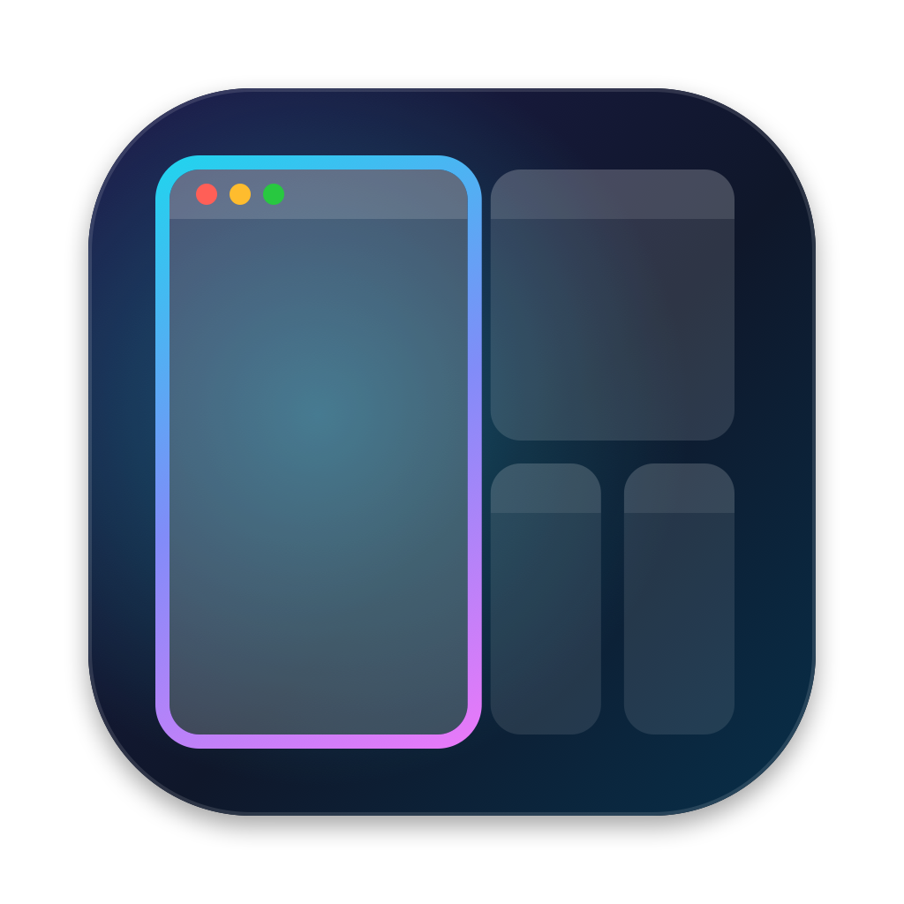

# HyprMac — macOS 向け Hyprland 風タイリングウィンドウマネージャ



動画「Why you should try Linux in 2027」(https://www.youtube.com/watch?v=mfyzIdSDWNM) で紹介されていた
Omarchy(Hyprland)のワークフローを macOS で再現するメニューバー常駐アプリです。

| 動画(Omarchy / Hyprland) | HyprMac |
|---|---|
| `Cmd+1..5` でアニメーションなしに一瞬でワークスペース切り替え | `$mod+1..0`。macOS の Spaces を使わず、非表示ワークスペースのウィンドウを画面隅に退避するので切り替えは一瞬 |
| `Cmd+S` でどのワークスペースの上にも出せる special workspace(メッセージアプリ置き場) | `$mod+S` でオーバーレイとして表示/非表示。Messages・Slack・Discord・LINE などはルールで自動的にここへ。通常ウィンドウをクリックすると自動で隠れる |
| ウィンドウを開くと重ならないよう自動整列(「四隅に1つずつ」) | Dwindle レイアウト。新しいウィンドウはアクティブなウィンドウを長辺方向に分割して配置 |
| ウィンドウの入れ替えが簡単 | `$mod+Shift+矢印` で入れ替え。マウスで別のウィンドウの上にドラッグしても入れ替え |
| メニューバー | メニューバーにワークスペース番号を表示(`1 2 [3]  S`) |

設定ファイルは **hyprland.conf と同じ書式** です(`bind = $mod, 1, workspace, 1`、`windowrule = ...`、`general { gaps_in = 5 }`)。

## ビルドと起動

Command Line Tools だけでビルドできます(Xcode は不要)。macOS 13 以降。

```bash
make app          # → build/HyprMac.app
make run          # ビルドしてフォアグラウンドで起動(ログは stderr、Ctrl-C で終了しウィンドウを元に戻す)
make install      # /Applications にコピー
make test         # レイアウトツリーと設定パーサのユニットテスト
make icon         # アイコン(Resources/AppIcon.icns)を scripts/make-icon.swift から再生成
```

初回起動時に **システム設定 → プライバシーとセキュリティ → アクセシビリティ** で HyprMac を許可してください。
許可されると自動的に管理を開始します(2秒ごとに確認)。
ad-hoc 署名のため、**再ビルドするたびに許可し直す必要があります**(一覧から `-` で削除して追加し直す)。

## 既定のキー(`$mod = ALT` = Option)

| キー | 動作 |
|---|---|
| `$mod + 1..9, 0` | ワークスペース 1〜10 に切り替え |
| `$mod + Shift + 1..0` | アクティブなウィンドウをワークスペースへ移動(フォーカスも追従) |
| `$mod + Tab` / `Shift+Tab` | 次 / 前の使用中ワークスペース |
| `` $mod + ` `` | 直前のワークスペース |
| `$mod + S` | special workspace(スクラッチパッド)の表示/非表示 |
| `$mod + Shift + S` | アクティブなウィンドウを special workspace へ送る |
| `$mod + 矢印` | フォーカス移動 |
| `$mod + Shift + 矢印` | ウィンドウ入れ替え(その方向に無ければ隣のモニタへ) |
| `$mod + J` | 分割方向の切り替え |
| `$mod + - / =` | 分割比率の変更 |
| `$mod + T` | フローティング切り替え |
| `$mod + F` | フルスクリーン(表示領域いっぱい) |
| `$mod + W` | ウィンドウを閉じる |
| `$mod + Return` | ターミナル |
| `$mod + , / .` | 左/右のモニタへフォーカス |
| `$mod + Shift + R` | 設定の再読み込み |

修飾キーの既定は **Option** です。`Cmd+S` や `Cmd+1..9` はほぼすべての Mac アプリで保存やタブ切り替えに
使われていて、HyprMac が横取りしてしまうためです。
動画と同じキーにしたい場合は設定で `$mod = SUPER`(= Command)に変更してください。

## 設定画面(GUI)

メニューバーの HyprMac アイコン →「設定…」(または ⌘,)で設定画面が開きます。
`HyprMac --settings` で設定画面だけを単独で開くこともできます(ウィンドウ管理は行いません)。

| タブ | 内容 |
|---|---|
| 一般 | 修飾キー `$mod` の選択、gaps_in / gaps_out、special workspace の大きさ、変数(`$terminal` など) |
| キー割り当て | 修飾キー・キー・動作・引数の編集、追加と削除、検索。⌨︎ ボタンを押してからキーを押すと組み合わせを記録できる。重複したキーには ⚠︎ を表示 |
| ウィンドウルール | フローティング / タイル / ワークスペース指定のルール。「実行中のアプリから追加」でアプリ名を正規表現に変換して追加 |
| 起動時コマンド | `exec-once` の編集 |

入力内容はその場で検証され、エラーがあると「保存して適用」は押せません。
保存すると設定ファイルを書き直してすぐに反映します(ファイル内のコメントは保持されません)。

## 設定ファイル

初回起動時に `~/.config/hyprmac/hyprmac.conf` が作成されます。**保存すると自動で再読み込み** されます。

```conf
$mod = ALT
general {
    gaps_in = 5
    gaps_out = 10
}
special {
    scale = 0.85          # 画面に対する special workspace の大きさ
}
exec-once = open -a Obsidian

windowrule = float, class:^(System Settings|Calculator)$
windowrule = workspace special, class:^(Slack|Messages)$
windowrule = workspace 2, class:^(Zen|Safari)$, title:.*
bind = $mod, Return, exec, open -na Terminal
bind = $mod, 1, workspace, 1
```

- `class:` はアプリ名またはバンドル ID にマッチ(正規表現、大文字小文字を区別しない)。`title:` はウィンドウタイトルにマッチ
- ディスパッチャ: `exec killactive workspace movetoworkspace movetoworkspacesilent togglespecialworkspace movefocus swapwindow movewindow togglefloating fullscreen togglesplit splitratio focusmonitor reload exit`
- ワークスペースの引数: `1`〜`99`、`special`、`e+1`、`e-1`、`previous`
- `HyprMac --check-config [PATH]` で設定ファイルを検証できます

## 仕組み

- Accessibility API(`AXUIElement` / `AXObserver`)でウィンドウの生成・終了・フォーカス・移動を監視し、ウィンドウの位置とサイズを設定
- 非表示ワークスペース: ウィンドウを画面右下の隅に移動し、1px だけ見える状態にする(AeroSpace と同じ方式)。SIP の変更も Spaces も不要
- グローバルキー: `CGEventTap` で一致したキー入力を横取り。最近の macOS では Carbon の `RegisterEventHotKey` で Option だけの組み合わせが使えないため
- 非表示ワークスペースのウィンドウをアクティブにすると(Cmd-Tab、Dock など)、そのワークスペースへ自動で切り替え
- 終了時(メニュー、Ctrl-C、SIGTERM)や「Pause Tiling」選択時は、隠れていたウィンドウをすべて画面内に戻す

```
Sources/HyprMacCore/   純粋なロジック(Dwindle ツリー、設定パーサ / ConfigDocument、方向探索)+ テスト
Sources/HyprMac/       AppKit/AX 層(WindowManager、KeyboardTap、StatusBar)と SwiftUI の設定画面
```

## 制限と注意

- macOS ネイティブのフルスクリーンや他の Space にあるウィンドウは管理しません。Space は1つで使ってください
  (AeroSpace と同様、システム設定 → デスクトップと Dock →「ディスプレイごとに個別の操作スペース」をオフ推奨)
- Hyprland のようなアクティブウィンドウの枠線・ぼかし・アニメーションはありません
- ダイアログやシート(`AXStandardWindow` 以外)は管理しません
- HyprMac がクラッシュするとウィンドウが画面隅に残ることがあります。再起動すれば画面内に戻ります
- 実機での動作確認はまだ十分ではありません(ビルドとユニットテストのみ確認済み)
